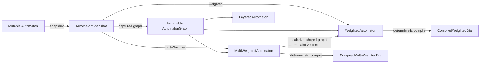

# Automaton documentation

This manual describes the **4.1.0-SNAPSHOT** development checkout. The published
4.0.0 release already includes scalar/vector weights; the direct `Automaton`
bridge and reusable `AutomatonSnapshot` are new in 4.1. Examples use Java 17 and
the actual checkout API. Build/install locally for unreleased additions; a Git
merge does not publish artifacts. See [Getting started](GETTING_STARTED.md).

## Read by topic

| Topic | Guide |
|---|---|
| Release changes, package map, migration from 3.0 / weighted snapshots | [Migration to 4.0](MIGRATION_4.md) |
| Installation, build, first program, running examples | [Getting started](GETTING_STARTED.md) |
| Maintainer signing, local Central bundle, validation and publication | [Release guide](../RELEASING.md) |
| States, integer intervals, epsilon, mutation and copying | [Automata and alphabets](AUTOMATA.md) |
| Integer expression syntax, precedence, parser API | [Regular expressions](REGULAR_EXPRESSIONS.md) |
| Boolean language operations and transformations | [Language operations](LANGUAGE_OPERATIONS.md) |
| Language predicates, counting, sampling, enumeration | [Language queries](LANGUAGE_QUERIES.md) |
| Compiled recognition, slices, incremental reading, factor search | [Compilation and search](COMPILATION_AND_SEARCH.md) |
| Direct Automaton → weights, reusable snapshots, Boolean projection | [Automaton and weights](AUTOMATON_AND_WEIGHTS.md) |
| Shared immutable graph, stable edge IDs, scalar word costs | [Weighted automata](WEIGHTED_AUTOMATA.md) |
| DAG/cyclic shortest paths, horizons and positional costs | [Paths and dynamic programming](PATHS_AND_HORIZONS.md) |
| Vectors, scalarization, lexicography, Pareto, scalar composition | [Multi-weighted automata](MULTI_WEIGHTED_AUTOMATA.md) |
| Weighted algebra, epsilon removal, determinization, minimization, K best | [Advanced algorithms](ADVANCED_ALGORITHMS.md) |
| Numeric conventions, thread safety, failures, algorithm selection | [Contracts and performance](CONTRACTS_AND_PERFORMANCE.md) |
| Every public type, constructor, method and overload | [API reference](API_REFERENCE.md) |
| Concrete answers to common API questions | [FAQ](FAQ.md) |

## Choose the right object

| Object | Representation and purpose |
|---|---|
| `Automaton` | Mutable Boolean DFA/NFA; construction, language algebra and queries |
| `CompiledDfa` | Immutable Boolean recognition snapshot; can determinize an NFA |
| `Searcher` | Immutable leftmost-longest factor-search preparation |
| `AutomatonSnapshot` | Captured structure and original object mappings; common entry into scalar/vector weights |
| `AutomatonGraph` | Immutable interval multigraph, stable logical edge IDs and CSR indexes |
| `WeightedAutomaton` | Additive scalar costs on a shared graph; ambiguous word costs are minima |
| `MultiWeightedAutomaton` | Additive vector costs; an ambiguous word denotes a set of vectors |
| `CompiledWeightedDfa` | Scalar DFA recognition with an interval index; requires a DFA without epsilon |
| `CompiledMultiWeightedDfa` | Vector DFA recognition; caller-buffer API and shared scalar indexes |
| `WeightedDfaIndex` | Immutable interval index shared by independently compiled scalar/vector weightings |
| `LayeredAutomaton` | Reusable finite-horizon structure with `(position,state)` nodes |

A path, a concrete word, a scalar cost, and a vector are different objects. Two
parallel paths can read the same word at different costs. Boolean operations
preserve a language; scalar operations preserve its minimum-cost function;
vector operations preserve the full word/vector relation unless Pareto filtering
is explicitly requested.

## Executable examples and detailed API

All Java blocks marked `example:` are copied verbatim from
[AutomatonTour.java](examples/AutomatonTour.java), including assertions about
results. The tour imports `fr.menana.automaton.*`,
`fr.menana.automaton.weighted.*`, `fr.menana.automaton.weighted.compiled.*`,
`fr.menana.automaton.regexp.*`, `java.util.*` and `java.math.BigInteger`.
Its `check(condition)` and `equal(expected,actual)` helpers throw an assertion
error on failure. These helper calls are checks, not library methods.

`check_examples.py` verifies that the snippets still match, compiles the tour
against this checkout, and executes all scenarios. The static API index is
produced by [generate_api_reference.py](generate_api_reference.py) from compiled
classes. Build the full Javadoc HTML with `mvn javadoc:javadoc`; open
`target/site/apidocs/index.html`. `mvn clean verify` also produces the attached
Javadoc JAR and the API HTML under `target/apidocs/` on the configured
Javadoc plugin. See [build instructions](GETTING_STARTED.md) for exact commands.

[Documentation index](README.md) · [API reference](API_REFERENCE.md)
